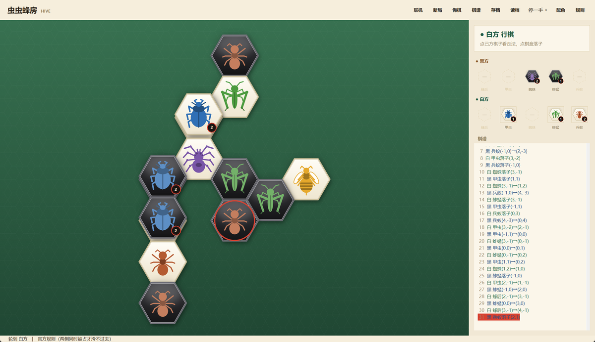
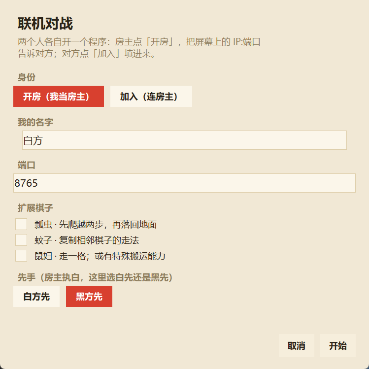

# 虫虫蜂房 · Hive

> Hive（昆虫棋）的 Windows 桌面版：本地双人 / 人机对战 / **局域网联机** / 复盘推演




用 Python + tkinter + Pillow 写的本地程序，规则按官方 Hive 执行，棋子、蜂巢和动画全部是
代码画的（没有用官方素材）。带一个会算路的电脑对手，可以两个人隔空下棋，也能把棋谱存下来
一步步复盘、试下。

## 下载

去 [Releases](../../releases/latest) 下最新的 zip（附件名 `chongchong-hive-lan-*.zip`，
显示名是「虫虫蜂房·局域网版」），解压到桌面或 D 盘，双击 `虫虫蜂房.exe` 就能玩。
**不需要装 Python，也不需要联网。**

> 注意：`虫虫蜂房.exe` 必须和同目录的 `_internal\` 文件夹放在一起，单独拷 exe 会打不开。

程序没有数字签名，第一次运行 Windows SmartScreen 可能提示「已保护你的电脑」：
点「更多信息」→「仍要运行」即可，只有第一次。

## 功能

- **只有官方规则**：自由移动 = 滑行时「门的两侧」同时被棋子占住才过不去，只被一侧挡着可以挤过去
- **三种对手**：本地两人对战 / 人机对战（简单・普通・困难）/ 局域网联机
- **局域网联机**：房主「开房」显示 `IP:端口`，对方「加入」填进来即可；走子实时同步，
  每步用校验码核对，不需要服务器
- **复盘与试下**：点棋谱任意一行回到那一步，`←` `→` 前后翻；复盘时点棋子 = 从这步开始
  试下，双方手牌自动还原，`Ctrl+M` 让电脑在试下局面走一步
- **悔棋 / 重做 / 提示 / 存档 / 读档 / 导出棋谱**
- **棋谱可视化**：蜘蛛选中后悬停能画出它绕行的三步路线；鼠妇能搬的棋子会套上橙圈
- **四套配色**（麻将风为默认）、`F11` 全屏（录视频用）
- **扩展棋子**：瓢虫、蚊子、鼠妇（含搬运）
- **电脑思考提示**：棋盘上方横幅 + 沙漏光标，思考跑在后台线程，超时用合法着法兜底

## 联机对战（局域网 / 直连 IP）

两个人各自开一个程序：

1. **房主**：顶栏「联机」→「开房（我当房主）」→ 选扩展和先手 →「开始」。
   屏幕上会显示 `房间已开：192.168.x.x:8765`，把这一串告诉对方。
2. **客人**：顶栏「联机」→「加入（连房主）」→ 填 IP 和端口 →「开始」。
3. 两边棋盘就同步了。房主执白、客人执黑，谁先走由房主开房时选。



- 同一个 WiFi 直接能连；不在同一个网里就用「异地组网」工具（Tailscale / ZeroTier /
  蒲公英之类）把两台电脑放进同一个虚拟局域网，或者做一次端口映射。
- **房主那边要放行防火墙**，否则对方会 `timed out`（只当客人不需要改任何设置）。
  管理员 PowerShell 跑一次即可：

  ```powershell
  New-NetFirewallRule -DisplayName "虫虫蜂房 联机" -Direction Inbound -Protocol TCP -LocalPort 8765 -Action Allow -Profile Any
  ```

- 联机时**不能悔棋、重做、试下**（会把对方的棋盘搞乱）；停一手、认输都走协议同步。
- 谁中途断线，另一边的棋盘留在原处，可以存档或复盘。

## 快捷键

| 键 | 作用 | 键 | 作用 |
|---|---|---|---|
| `Ctrl+N` | 新局 | `Ctrl+Z` | 悔棋 |
| `Ctrl+Y` | 重做 | `Ctrl+S` / `Ctrl+O` | 存档 / 读档 |
| `Ctrl+H` | 提示 | `Ctrl+M` | 试下时让电脑走 |
| `F5` | 换配色 | `F11` | 全屏 |
| `←` `→` | 复盘翻页 | `Esc` | 取消选择 / 退出试下 |

## 从源码运行

```powershell
pip install -r requirements.txt
python main.py
```

需要 Windows 10/11 + Python 3.10+（开发和测试用的是 3.14），Pillow 是唯一的第三方依赖。

## 打包成 exe

见 [BUILD.md](BUILD.md)。一条命令：

```powershell
python -m PyInstaller --noconfirm packaging\虫虫蜂房.spec
```

## 测试

10 套自测，全绿才算能打包（都是「跑起来看断言」的脚本，不依赖 pytest）：

```powershell
python -m tests.test_rules      # 规则内核：落子、走法、一巢、官方自由移动
python -m tests.test_relaxed    # 官方规则：界面文案 + 窄门判定
python -m tests.test_ui         # 界面点击：落子、选子、走子、存读档、终局
python -m tests.test_net        # 联机：协议、拆包、握手、房主/客人两侧同步
python -m tests.test_features   # 复盘 / 试下 / 鼠妇搬运
python -m tests.test_trial      # 试下推演
python -m tests.test_load       # 读档 / 看门狗
python -m tests.test_ai_turn    # 电脑走棋触发
python -m tests.test_ai         # 电脑不会走自杀的一手
python -m tests.test_ring       # 蜂后气口预警
```

## 项目结构

```
main.py                入口（崩溃日志、异常钩子、启动界面）
hive/
    rules.py           规则内核：棋盘、走法生成、胜负、存读档格式
    ai.py              电脑对手：评估函数 + 搜索 + 开局库
    ui.py              tkinter 界面（棋盘、棋盒、棋谱、对话框）
    net.py             局域网联机：TCP + 长度前缀 JSON、握手、校验码
    art.py             棋子与蜂巢的程序化绘制、四套配色
    store.py           存档 / 棋谱 / 设置
    book.py            开局库
    assets/            图标、规则图解
tests/                 10 套自测脚本
分析/                  开发期的分析工具（局面探针、对局回放、两版引擎对打等）
棋谱/                  对局记录（.hive，JSON）
packaging/             PyInstaller 打包配置
docs/screenshots/      README 用的截图
```

## 电脑对手怎么想棋

- 搜索：迭代加深 + alpha-beta + 置换表；三档难度的时间预算 0.05s / 1.2s / 6.0s
- 评估：蜂后的气口（对手一手能同时摘掉几口气）、甲虫压制、把对方子压成「桥」、
  己方被钉死、到对方蜂后的距离、先手轴（能动的子力差）
- **分级预警**：T = 我一步被杀 / TT = 两步 / TTT = 三步，V 是我围死对手的对称量；
  只有搜索真的找到「无论对方怎么应都能围死」的路线才给分，算不出来就不给分
- 开局库：从 `棋谱/` 里统计出来的着法频次，启动后自动更新
- 兜底：思考在后台线程，有硬超时，绝不会把界面卡死

想调参可以看 [评分模型.md](评分模型.md)，踩过的坑记在 [开发笔记.md](开发笔记.md)，
每轮交接记在 [交接摘要.md](交接摘要.md)。

## 已知不足

- 规则说明里「窄门」的图解还没重画（旧图画的是已经废弃的强规则，已从界面撤下）
- 联机断线后要重开一局，暂时不能续连；也还没有聊天和观战
- 只有直连：没有公网中继服务器，跨网需要用户的组网工具
- 只在 Windows 上验证过（tkinter 本身跨平台，但字体和 DPI 适配是按 Windows 调的）

## 致谢与声明

- 玩法与规则来自官方 Hive 规则书；**Hive 是 Gen42 Games 的商标**，本项目是爱好者写的
  非官方实现，与 Gen42 无关，仅供学习和交流
- 所有图形（棋子、蜂巢、图标、规则图）都是代码画的，没有使用官方美术素材

## 许可

[MIT](LICENSE)
